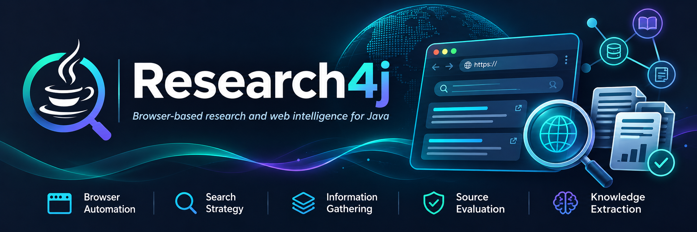

<p align="center"></p>

# Research4j

Browser-based research and web intelligence for Java: browser automation, search strategy, information gathering, source evaluation and knowledge extraction as reusable libraries.

Reusable Java research and browser components extracted from [Ask AI](https://github.com/aresstack/askai) at commit [3dfeecee60b1ee7db9e7cbead98cef13240ff0b6](https://github.com/aresstack/askai/commit/3dfeecee60b1ee7db9e7cbead98cef13240ff0b6). Ask AI remains unchanged; migration is tracked in [Ask AI #292](https://github.com/aresstack/askai/issues/292).

## Modules

- browser-api, browser-playwright, browser-search-analysis, browser-static-http
- web-search-providers, serp4j-playwright-google
- research-domain, research-agent-runtime
- agent-model-runtime-api, mcp-runtime-api (neutral host contracts)

The original Java packages and resources are retained to minimize migration changes. Java 21 matches the upstream build. The Playwright backend uses playwright4j and requires isolation from older GraalJS versions in host applications.

## Build

Resolve Serp4j 0.1.0 and all other external dependencies directly from Maven Central. No local Maven publication is required. Then run:

```sh
bash gradlew clean build
bash gradlew publishToMavenLocal
```

Ask AI host-dependent tests remain in the source tree but are explicitly excluded from the standalone test source set until replaced with host-neutral fixtures. The existing Firefox channel is retained; persistent Firefox profiles, extension loading, intranet access policy and Space Harvester integration require separate validation.

## License

MIT; see LICENSE.

## Verification and releases

The default build runs library tests without a live browser or model. Environment-dependent tests named
`*Live*Test` run separately via `bash gradlew liveTest`. For example, select the installed Firefox with
`ASKAI_TEST_BROWSER_CHANNEL=firefox bash gradlew :browser-playwright:liveTest --tests '*PlaywrightLiveBrowserTest'`.
The host-dependent tests listed in research-agent-runtime/build.gradle still require standalone host fixtures.
Firefox history navigation currently fails with playwright4j 0.3.0 (see https://github.com/aresstack/playwright4j/issues/79).
Do not treat the baseline library as acceptance of the Space Harvester integration.

Build signed release bundles in GitHub Actions on a version tag. Central Portal credentials and signing
keys are supplied by the existing organization secrets. The portal verification timeout is two hours.
Locally, `bash gradlew zipAggregation -PreleaseVersion=0.1.0` builds an unsigned bundle without uploading it.